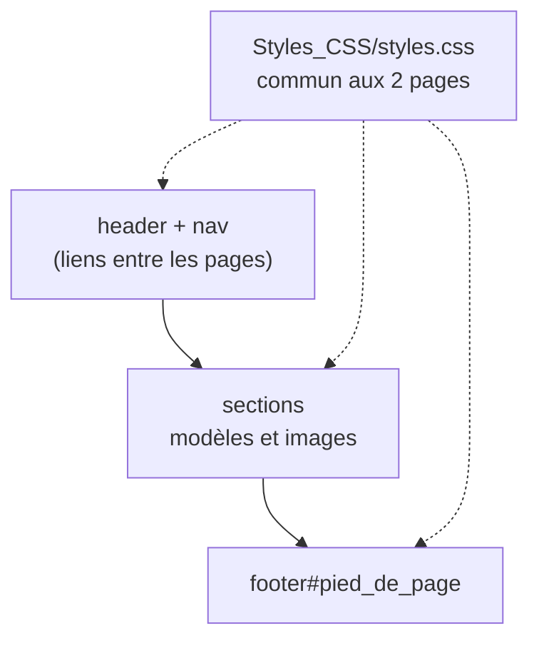

<div align="center">

# 🎨 Apprentissage HTML & CSS — Luxury Car

**Mon premier site web : une vitrine de voitures de luxe en HTML5 et CSS3, réalisée en autodidacte.**


</div>

---

## ✨ Le site

Un concessionnaire fictif de voitures d'exception, sur deux pages :

| Page | Contenu |
|---|---|
| **Accueil** (`luxury_car.html`) | en-tête, menu de navigation, présentation des modèles (Bugatti, McLaren, Lamborghini Huracán et Urus, Nissan GT-R50, Rolls-Royce), pied de page |
| **Achat** (`Autre_Pages/achat.html`) | location et contact, même structure de navigation |

Une seule feuille de style commune met en page les deux pages, avec des effets au survol.

---

## 🚀 Voir le site

```bash
git clone https://github.com/Flavien-Audinet/Cours-autodidacte-HTML-CSS.git
open Cours-autodidacte-HTML-CSS/luxury_car/luxury_car.html      # macOS
start Cours-autodidacte-HTML-CSS\luxury_car\luxury_car.html     # Windows
```

Aucun serveur n'est nécessaire : tout est statique.

---

## ⚙️ Structure des pages



Notions travaillées : balises sémantiques HTML5 (`header`, `nav`, `section`, `footer`), liens relatifs entre pages et dossiers, sélecteurs CSS, `:hover` et `transition`.

---

## 🗂️ Organisation des fichiers

```
Cours-autodidacte-HTML-CSS/
└── luxury_car/
    ├── luxury_car.html        page d'accueil
    ├── Autre_Pages/
    │   └── achat.html         page location / contact
    ├── Styles_CSS/
    │   └── styles.css         feuille de style commune
    └── Images_Du_Site/        logo, fond et photos des modèles
```

---

## 💻 Compatibilité

Tout navigateur récent (Firefox, Chrome, Safari, Edge).

---

## 📜 Licence

Code : MIT — voir [LICENSE](LICENSE). Les photos de voitures et les marques citées appartiennent à leurs propriétaires ; elles ne servent qu'à illustrer cet exercice.

---

<div align="center"><sub>HTML5 · CSS3 · décembre 2024</sub></div>
